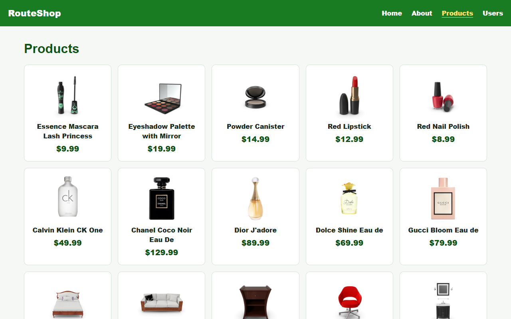

# RouteShop: React Router practice app

[](https://codelady-ship.github.io/React-Routing-task4/)
[](https://github.com/codelady-ship/React-Routing-task4/actions/workflows/deploy.yml)

A small multi-page React app built to practise client-side routing. It lists products from the
[DummyJSON](https://dummyjson.com) API, opens each product on its own URL (`/product/:id`), shows a list of sample
users and has a 404 page for unknown routes.

> AZ: React Router ilə marşrutlaşdırma təcrübəsi: məhsul siyahısı, `/product/:id` səhifəsi, istifadəçilər və 404 səhifəsi.



## Features

- Home, About, Products, Product detail, Users and 404 pages
- `NavLink` menu that highlights the active page, with a toggle menu on phones
- Dynamic route `/product/:id` read with `useParams`; the data reloads when the id changes
- Loading and error states for every request (including "no product with id N")
- Users page loaded from DummyJSON `/users`
- Responsive CSS grid layouts from 390 px to 1920 px
- SEO basics: title per page, meta description, canonical, Open Graph/Twitter tags, `robots.txt`, `sitemap.xml`

## Tech stack

React 19 · React Router 7 · Axios · Vite 6 · plain CSS · GitHub Actions + GitHub Pages

## Run locally

```bash
git clone https://github.com/codelady-ship/React-Routing-task4.git
cd React-Routing-task4
npm install
npm run dev      # http://localhost:5173/React-Routing-task4/
npm run build    # production build in dist/ (also writes dist/404.html for SPA routes)
npm run preview
```

## Deployment

`vite.config.js` sets `base: '/React-Routing-task4/'` and `BrowserRouter` uses `basename={import.meta.env.BASE_URL}`.
`.github/workflows/deploy.yml` builds on every push to `main` and publishes `dist/` to the `gh-pages` branch, which
GitHub Pages serves. `dist/404.html` is a copy of `index.html`, so deep links such as `/product/5` work.

## What I learned

- Link paths must match the route table exactly: the list linked to `/products/:id` while the route was `/product/:id`.
- Start fetched state as `null` and render a loading state, otherwise the first render shows broken images and
  `$undefined`. Put the URL param in the effect's dependency list so the page updates when it changes.
- Apps served from a sub-path need both the Vite `base` and the router `basename`.
- `node_modules` and the `.vite` cache never belong in git.
